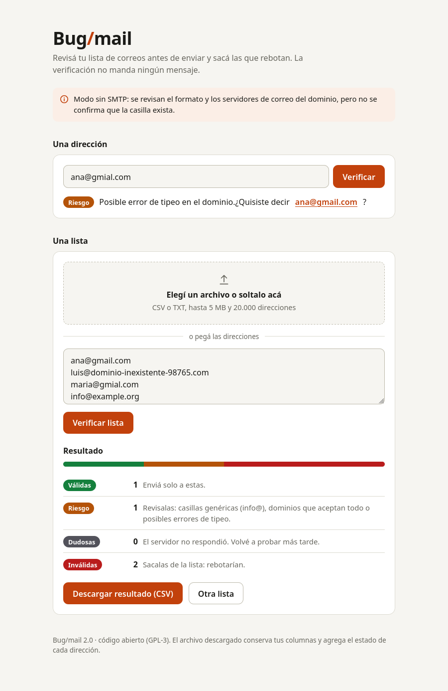

# Bug/mail

Clean an e-mail list **before** you send to it: fewer bounces, better sender reputation.

Bug/mail checks each address in layers and sorts it as `valid`, `risky`, `unknown` or `invalid`:

1. **Syntax**: malformed addresses are dropped without touching the network.
2. **Typos**: `ana@gmial.com` is flagged with the suggestion `ana@gmail.com` (the typo domain often exists and has mail servers, so DNS alone would call it fine).
3. **Disposable domains** and **role accounts** (`info@`, `ventas@`...) are marked `risky`.
4. **DNS**: the domain must exist and accept mail (MX, or the A-record fallback).
5. **SMTP handshake**: connects to the domain's mail servers, asks `RCPT TO:<address>` and **never sends a message**. Tries up to three servers in preference order.
6. **Catch-all detection**: asks about a random address too. If the server accepts that one as well, it accepts everything, so a "yes" for your address means nothing and the result is `risky`.

Results are cached **per domain**, connections to the same mail server are spaced out (default 1 s), and each address is only checked once even if the list repeats it.



## Install

```bash
python3 -m venv .venv
.venv/bin/pip install -e .
```

Python 3.10+, with `flask` and `dnspython`.

## Use

```bash
# Is outbound port 25 open from here? (see "Limits" below)
bugmail doctor

# One address
bugmail check ana@example.com

# A whole list: CSV (any delimiter) or one address per line
# (the sample only shows the file format: its example.* domains are reserved and accept no mail)
bugmail file examples/sample.csv -o result.csv

# Web interface at http://127.0.0.1:5000
bugmail serve
```

The result file keeps your original columns and adds `bugmail_status`, `bugmail_reason` and `bugmail_suggestion`. Useful options: `--no-smtp` (syntax + DNS only), `--workers 8`, `--interval 1.0` (seconds between connections to the same mail server), `--helo mail.yourdomain.com`, `--sender verify@yourdomain.com`, `--disposable-file my-list.txt`.

**What to do with the verdicts:** send to `valid`; review `risky` (role accounts, catch-all domains, possible typos); retry `unknown` later (greylisting, timeouts); drop `invalid`.

## Limits (read this)

- **Outbound port 25 is blocked** by many home ISPs and cloud providers. `bugmail doctor` tells you. If it is blocked, run Bug/mail from a server where it is open, or use `--no-smtp`.
- **No verifier is exact.** Some servers accept every address and bounce later (that is what catch-all detection is for); some block verification probes; some answer "temporary failure" on purpose (greylisting). Those end up as `risky` or `unknown`, not as a false "valid".
- **Large volumes from one IP can get that IP blocklisted.** Keep the default spacing, do not hammer a single provider, and prefer your own sending provider's bounce reports as the final source of truth.
- Mail servers on private/LAN addresses are refused by default (`--allow-private` to override), so the web interface cannot be used to probe internal networks.
- The web interface has **no login**. It listens on `127.0.0.1` by default; put authentication in front of it before exposing it.

## Responsible use

Use it to clean **your own** list, made of people who gave you their address. It is not meant for collecting or guessing other people's addresses. If you handle personal data, check the law that applies to you (for example Argentina's Ley 25.326 or the GDPR).

## Develop

```bash
.venv/bin/pip install -e .[dev]
.venv/bin/python -m pytest
```

The tests use a fake DNS and a fake SMTP server, with fictional addresses; they never touch the network.

## License

GPL-3.0-or-later. If you find it useful you can [buy me a coffee](https://cafecito.app/cufanic).
